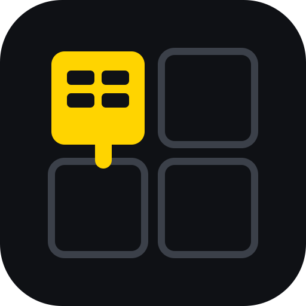

# QuadNav — a VRG app

Chrome extension. Keyboard navigation that picks a quarter of the screen first, then labels
only the links inside it. Left hand on `Alt`+`1`; the right hand never leaves the mouse.

**Status: first release in preparation.** The source lands here with the first release; the
packaged zip will be on the [Releases](https://github.com/vrgli/quadnav/releases) page.

## Fork it

Once the source is here:

1. Click **Fork** at the top of this page, then clone your fork.
2. In Chrome, open `chrome://extensions`, switch on **Developer mode**, click **Load unpacked**
   and pick the extension folder.

Vanilla JS, zero dependencies, nothing to build. No account, no server, no telemetry.

## Logo

The QuadNav mark lives in [`logo/`](logo/): `logo.svg` (source), `logo-512.png` and `logo-128.png` (the Chrome extension icon). Near-black and VRG yellow, like everything else at vrg.li.

## Licence

MIT plus one condition — see [LICENSE.md](LICENSE.md): any usable copy keeps a visible
"A VRG app" credit linking to https://vrg.li. The extension shows it on its options page.

A VRG app · https://vrg.li · more apps: https://github.com/vrgli/apps
